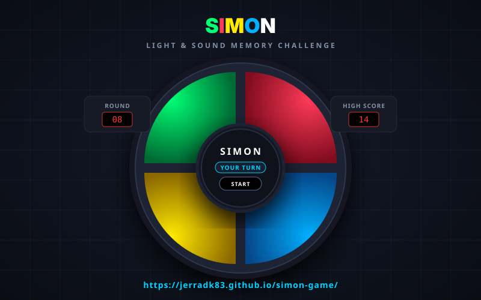

# 🎮 Simon Memory Game - Retro Arcade Edition

A classic electronic memory game recreation inspired by the legendary Ralph Baer Simon console. Built with pure HTML5, CSS3, and JavaScript featuring authentic Web Audio API sound synthesis and responsive arcade styling.



## 🌟 Live Demo

Play the live game directly in your browser:  
👉 **[https://jerradk83.github.io/simon-game/](https://jerradk83.github.io/simon-game/)**

---

## 🕹️ Features

- **Classic 4-Quadrant Simon Board**:
  - 🟩 **Green** (Top-Left) &bull; Tone: 415.3 Hz (G#4) &bull; Shortcut: `Q`
  - 🟥 **Red** (Top-Right) &bull; Tone: 311.13 Hz (D#4) &bull; Shortcut: `W`
  - 🟨 **Yellow** (Bottom-Left) &bull; Tone: 252.28 Hz (B3) &bull; Shortcut: `A`
  - 🟦 **Blue** (Bottom-Right) &bull; Tone: 209.25 Hz (G3) &bull; Shortcut: `S`
- **Authentic Synthesized Audio**: Built-in oscillators via Web Audio API—no external audio files required!
- **Strict Mode Toggle**:
  - *Normal Mode*: 3 lives with "Try Again" replay on missteps.
  - *Strict Mode*: One wrong move ends the game immediately!
- **Dynamic Difficulty**: Sequence tempo dynamically quickens at rounds 5, 9, and 13.
- **Multiple Speed Settings**: Classic, Fast, and Insane speed modes.
- **High Score Tracking**: Automatically saves your personal best locally using `localStorage`.
- **Celebration Effects**: Confetti burst and victory fanfare at milestone rounds.
- **Full Responsiveness**: Seamless experience on smartphones, tablets, laptops, and desktop screens with zero tap delays.

---

## 🎯 How to Play

1. Click **START** (or press `Spacebar`).
2. Watch the colored pads illuminate and listen to their tones.
3. Repeat the exact sequence in order by clicking/tapping or using keys `Q`, `W`, `A`, `S`.
4. After every successful round, Simon adds one more color to the sequence.
5. See how long you can keep up!

---

## 🚀 GitHub Pages Setup

To make this game public and accessible from your GitHub Pages:

1. Create a new public repository on GitHub named `simon-game`.
2. Push this project to the `main` branch:
   ```bash
   git init
   git add .
   git commit -m "Initial commit of Simon Game"
   git branch -M main
   git remote add origin https://github.com/jerradk83/simon-game.git
   git push -u origin main
   ```
3. In your GitHub repository:
   - Go to **Settings** > **Pages**
   - Under **Build and deployment** > **Branch**, select `main` and `/ (root)`
   - Click **Save**
4. Your game will be live at:  
   `https://jerradk83.github.io/simon-game/`

---

## 📄 License

MIT License. Free to use, modify, and distribute.
